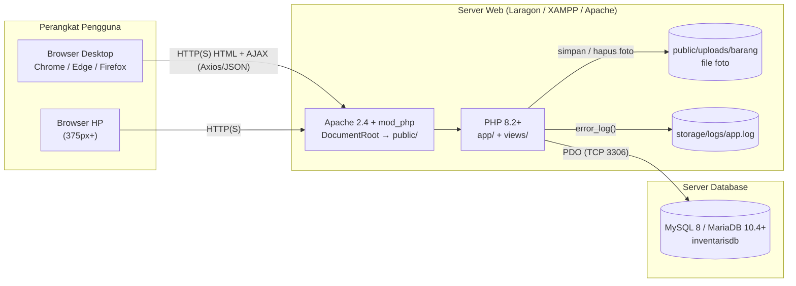

# Infrastruktur & Kebutuhan Sistem — SI Inventaris Sekolah

Dokumen ini menjelaskan kebutuhan perangkat keras, perangkat lunak, library, konfigurasi, dan
langkah setup dari nol hingga aplikasi berjalan (development, testing, dan server sekolah).

---

## 1. Topologi Sistem



Untuk sekolah, aplikasi cukup dijalankan pada **satu PC server di jaringan lokal (LAN)**; web server
dan database boleh berada di mesin yang sama.

## 2. Kebutuhan Perangkat Keras

| Peran | Minimum | Rekomendasi |
|---|---|---|
| PC Developer / Ujian | CPU 2 core, RAM 4 GB, SSD 10 GB kosong | CPU 4 core, RAM 8 GB |
| Server sekolah (LAN, ≤ 30 pengguna bersamaan) | CPU 2 core, RAM 4 GB, disk 20 GB | CPU 4 core, RAM 8 GB, SSD 50 GB, UPS |
| Klien | Perangkat dengan browser modern, layar ≥ 360px | — |
| Jaringan | LAN 100 Mbps / WiFi | LAN 1 Gbps, IP statis untuk server |

Estimasi penyimpanan: 5.000 barang × foto rata-rata 300 KB ≈ **1,5 GB** + database < 50 MB.

## 3. Kebutuhan Perangkat Lunak

### 3.1 Runtime (wajib)

| Komponen | Versi | Catatan |
|---|---|---|
| PHP | **8.2 atau 8.3** | Terdeteksi: XAMPP PHP 8.2.12 (di PATH), Laragon PHP 8.3.26 |
| Ekstensi PHP | `pdo`, `pdo_mysql`, `mbstring`, `fileinfo`, `session`, `json`, `openssl` | Semua sudah aktif di PHP 8.2.12 XAMPP |
| Web server | Apache 2.4 dengan `mod_rewrite` & `AllowOverride All` | Atau PHP built-in server untuk dev |
| Database | **MySQL 8.0+** atau **MariaDB 10.4+** | Terdeteksi: Laragon MySQL 8.4.3, XAMPP MariaDB |
| Browser | Chrome/Edge/Firefox 2 versi terakhir | Untuk pengguna & E2E |

### 3.2 Tools pengembangan

| Tool | Versi | Fungsi |
|---|---|---|
| Composer | 2.9.x | Instal PHPUnit (dev) |
| Node.js + npm | Node 24.x | Menyalin library frontend, menjalankan Playwright |
| Git | 2.51+ | Version control |
| phpMyAdmin / HeidiSQL | bawaan Laragon/XAMPP | Import `database/inventarisdb.sql`, inspeksi data |
| VS Code (opsional) | — | Editor; ekstensi PHP Intelephense, EditorConfig |

### 3.3 Library (versi dikunci)

| Library | Versi | Lisensi | Jenis | Dipakai untuk | Lokasi runtime |
|---|---|---|---|---|---|
| Bootstrap | 5.3.8 | MIT | CSS + JS (bundle + Popper) | Grid, komponen, navbar, form | `public/assets/vendor/bootstrap/` |
| Bootstrap Icons | 1.11.3 | MIT | Icon font | Ikon menu, tombol, kartu | `public/assets/vendor/bootstrap-icons/` |
| Axios | 1.7.9 | MIT | JS | AJAX (statistik, kode barang, hapus) | `public/assets/vendor/axios/` |
| Chart.js | 4.4.7 | MIT | JS | Grafik dashboard | `public/assets/vendor/chartjs/` |
| SweetAlert2 | 11.26.25 | MIT | JS + CSS | Dialog konfirmasi & toast | `public/assets/vendor/sweetalert2/` |
| PDO | bawaan PHP | PHP License | PHP | Akses database | ekstensi PHP |
| PHPUnit | ^11.5 | BSD-3 | dev | Unit & integration test | `vendor/` (tidak dibutuhkan runtime) |
| @playwright/test | 1.64.0 | Apache-2.0 | dev | E2E test | `node_modules/` (tidak dibutuhkan runtime) |

> Semua aset runtime **disalin ke repo** oleh `npm run vendor` (script `scripts/copy-vendor.mjs`)
> sehingga aplikasi berjalan **offline**. Runtime tidak boleh memuat CDN.

## 4. Konfigurasi Aplikasi

Konfigurasi ada di `config/config.php` (disalin dari `config/config.example.php`, **tidak di-commit**).
Setiap nilai dapat ditimpa *environment variable* — dipakai oleh PHPUnit & Playwright.

| Kunci | Env override | Default | Keterangan |
|---|---|---|---|
| `app.name` | — | `SI Inventaris Sekolah` | Judul aplikasi |
| `app.env` | `APP_ENV` | `local` | `local` / `testing` / `production` |
| `app.debug` | `APP_DEBUG` | `true` | `false` di server sekolah (pesan error generik) |
| `app.base_url` | `APP_BASE_URL` | `http://localhost:8000` | URL root yang mengarah ke `public/`, **tanpa** garis miring akhir |
| `app.timezone` | — | `Asia/Jakarta` | Zona waktu PHP |
| `db.host` / `db.port` | `DB_HOST` / `DB_PORT` | `127.0.0.1` / `3306` | Server MySQL |
| `db.name` | `DB_NAME` | `inventarisdb` | Test memakai `inventarisdb_test` |
| `db.user` / `db.password` | `DB_USER` / `DB_PASSWORD` | `root` / *(kosong)* | Ganti di server sekolah |
| `db.timezone` | — | `+07:00` | `SET time_zone` per koneksi |
| `upload.max_bytes` | — | `2097152` (2 MB) | Batas ukuran foto |
| `security.login_max_attempts` | — | `5` | Batas gagal login |
| `security.login_decay_minutes` | — | `15` | Jendela waktu rate limit |
| `pagination.per_page` | — | `10` | Baris per halaman |

### Nilai `app.base_url` per lingkungan

| Cara menjalankan | `app.base_url` |
|---|---|
| `php -S localhost:8000 -t public` | `http://localhost:8000` |
| Laragon auto virtual host (folder di `C:\laragon\www\sistem_inventaris`) | `http://sistem_inventaris.test` |
| Laragon/XAMPP subfolder | `http://localhost/sistem_inventaris` |
| Playwright E2E (otomatis) | `http://127.0.0.1:8080` |

Root `.htaccess` me-rewrite semua request ke `public/`, sehingga folder `app/`, `config/`,
`database/`, `views/`, `tests/` **tidak dapat diakses dari browser** saat memakai Apache.

## 5. Pengaturan PHP (`php.ini`)

| Direktif | Dev | Produksi | Alasan |
|---|---|---|---|
| `upload_max_filesize` | `4M` | `4M` | > batas aplikasi 2 MB agar pesan validasi aplikasi yang tampil |
| `post_max_size` | `8M` | `8M` | Menampung form + foto |
| `file_uploads` | `On` | `On` | Upload foto |
| `display_errors` | `On` | `Off` | Jangan bocorkan detail error |
| `log_errors` | `On` | `On` | Dicatat ke `storage/logs/app.log` (diatur aplikasi) |
| `session.use_strict_mode` | `1` | `1` | Diatur juga oleh aplikasi |
| `session.cookie_httponly` | `1` | `1` | Diatur aplikasi |
| `expose_php` | `Off` | `Off` | Sembunyikan versi PHP |
| `extension=pdo_mysql`, `fileinfo`, `mbstring` | aktif | aktif | Wajib |

## 6. Setup Lingkungan Development (Langkah demi Langkah)

### 6.1 Siapkan database
1. Jalankan **Laragon → Start All** (atau XAMPP Control Panel → Start Apache & MySQL).
2. Cek MySQL aktif: HeidiSQL/phpMyAdmin dapat terhubung ke `127.0.0.1:3306` user `root`.
3. Buka phpMyAdmin → tab **Import** → pilih `database/inventarisdb.sql` → **Go**.
   (HeidiSQL: *File → Run SQL file…*). Database `inventarisdb` + seed langsung terbentuk.

### 6.2 Siapkan kode
```bash
cd "D:/porto vibe/sertikom web/sistem_sekolah/sistem_inventaris"
cp config/config.example.php config/config.php   # lalu sesuaikan db.password bila perlu
composer install
npm install
npm run vendor
```

### 6.3 Jalankan
```bash
php -S localhost:8000 -t public
```
Buka `http://localhost:8000` → login `admin / admin123` atau `petugas / petugas123`.

### 6.4 Alternatif Laragon (Apache)
1. Salin/symlink folder ke `C:\laragon\www\sistem_inventaris`.
2. Laragon → Menu → Apache → *reload*; akses `http://sistem_inventaris.test`.
3. Set `app.base_url` = `http://sistem_inventaris.test` di `config/config.php`.

## 7. Lingkungan Testing

| Jenis | Perintah | Kebutuhan | Database |
|---|---|---|---|
| Unit | `composer test:unit` | PHP + Composer | Tidak perlu |
| Integration | `composer test:integration` | MySQL aktif, user `root` boleh `CREATE/DROP DATABASE` | `inventarisdb_test` (di-drop & dibuat ulang dari file SQL) |
| E2E | `npm run test:e2e` | Node, Chromium Playwright (`npx playwright install chromium`, ±150 MB unduhan), MySQL | `inventarisdb_test` di-reset di `global-setup` |
| Coverage | `composer test -- --coverage-text` | **pcov atau xdebug** (belum terpasang di mesin ini) | sama |

> Mesin saat ini **belum punya pcov/xdebug**. Untuk mengukur target coverage 80%, aktifkan xdebug di
> Laragon (Menu → PHP → Extensions → xdebug) atau pasang `php_pcov.dll` yang cocok dengan versi PHP,
> lalu set `xdebug.mode=coverage`.

Pengaman: `TestDatabase::reset()` **menolak** berjalan jika nama database tidak berakhiran `_test`.

## 8. Deployment ke Server Sekolah (LAN)

1. Instal Laragon/XAMPP di PC server, set IP statis (mis. `192.168.1.10`).
2. Salin folder proyek **tanpa** `node_modules/`, `tests/`, `vendor/` (tidak dibutuhkan runtime).
3. Import `database/inventarisdb.sql`; **segera ganti password akun seed** (update hash via
   `php -r "echo password_hash('PasswordBaru', PASSWORD_BCRYPT);"`).
4. Buat user MySQL khusus aplikasi (jangan `root`):
   ```sql
   CREATE USER 'inventaris_app'@'localhost' IDENTIFIED BY '<password-kuat>';
   GRANT SELECT, INSERT, UPDATE, DELETE ON inventarisdb.* TO 'inventaris_app'@'localhost';
   FLUSH PRIVILEGES;
   ```
5. `config/config.php`: `app.env=production`, `app.debug=false`, `app.base_url=http://192.168.1.10/sistem_inventaris`, kredensial user di atas.
6. Pastikan `public/uploads/barang/` dan `storage/logs/` dapat ditulis oleh proses Apache.
7. Opsional: aktifkan HTTPS (Laragon → Apache → SSL) agar cookie `Secure` aktif otomatis.
8. Uji: login, tambah barang + foto, hapus, dashboard, akses `http://<server>/sistem_inventaris/config/config.php` harus **tidak** menampilkan isi file.

## 9. Backup & Pemulihan

| Item | Cara | Frekuensi |
|---|---|---|
| Database | HeidiSQL *Export database as SQL* atau `mysqldump -u root inventarisdb > backup-YYYYMMDD.sql` (bin Laragon: `C:\laragon\bin\mysql\mysql-8.4.3-winx64\bin`) | Harian |
| Foto | Salin folder `public/uploads/barang/` | Mingguan |
| Pemulihan | Import file backup via phpMyAdmin, salin kembali folder foto | Saat dibutuhkan |

## 10. Checklist Kesiapan Lingkungan

- [ ] `php -v` ≥ 8.2 dan `php -m` memuat `pdo_mysql`, `fileinfo`, `mbstring`
- [ ] MySQL aktif di `127.0.0.1:3306`
- [ ] `database/inventarisdb.sql` berhasil di-import (5 tabel, 15 barang)
- [ ] `config/config.php` ada dan `app.base_url` benar
- [ ] `public/assets/vendor/` berisi bootstrap, bootstrap-icons, axios, chartjs, sweetalert2
- [ ] `public/uploads/barang/` & `storage/logs/` dapat ditulis
- [ ] `composer test:unit` lulus
- [ ] Login `admin/admin123` berhasil di browser
