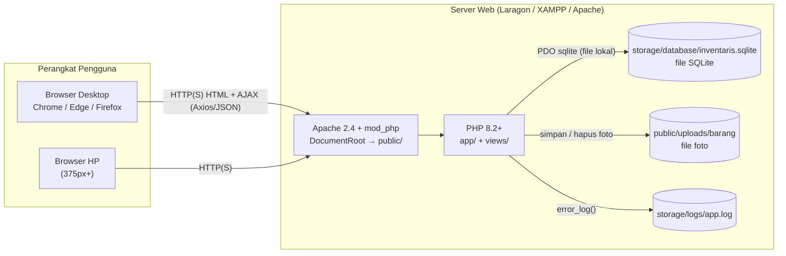

# Infrastruktur dan Kebutuhan Sistem: SI Inventaris Sekolah

Dokumen ini menjelaskan kebutuhan perangkat keras, perangkat lunak, library, konfigurasi, dan langkah setup dari nol sampai aplikasi berjalan (development, testing, dan server sekolah).

> **Database = satu file SQLite.** Tidak ada server database (MySQL/MariaDB) yang perlu dipasang atau dijalankan. Detail skema ada di [04-DATABASE.md](04-DATABASE.md).

---

## 1. Topologi Sistem



Untuk sekolah, aplikasi cukup dijalankan pada **satu PC server di jaringan lokal (LAN)**. Web server dan file database berada di mesin yang sama.

## 2. Kebutuhan Perangkat Keras

| Peran | Minimum | Rekomendasi |
|---|---|---|
| PC developer / ujian | CPU 2 core, RAM 4 GB, SSD 10 GB kosong | CPU 4 core, RAM 8 GB |
| Server sekolah (LAN, sampai 30 pengguna bersamaan) | CPU 2 core, RAM 4 GB, disk 20 GB | CPU 4 core, RAM 8 GB, SSD 50 GB, UPS |
| Klien | Browser modern, layar 360px ke atas | |
| Jaringan | LAN 100 Mbps / WiFi | LAN 1 Gbps, IP statis untuk server |

Estimasi penyimpanan: 5.000 barang dengan foto rata-rata 300 KB sekitar **1,5 GB** untuk foto. File database SQLite sekitar belasan MB untuk data tersebut.

## 3. Kebutuhan Perangkat Lunak

### 3.1 Runtime (wajib)

| Komponen | Versi | Catatan |
|---|---|---|
| PHP | **8.2 atau 8.3** | Di mesin ini: XAMPP PHP 8.2.12 (di PATH) dan Laragon PHP 8.3 |
| Ekstensi PHP | `pdo`, `pdo_sqlite`, `mbstring`, `fileinfo`, `session`, `json`, `openssl` | Semua sudah aktif di PHP 8.2 XAMPP. `pdo_sqlite` adalah ekstensi yang sekarang diperlukan |
| Web server | Apache 2.4 dengan `mod_rewrite` dan `AllowOverride All`, atau PHP built-in server untuk development | |
| Database | **SQLite 3** (bawaan PHP, lewat PDO) | Tidak perlu instalasi atau layanan terpisah |
| Browser | Chrome, Edge, atau Firefox dua versi terakhir | Untuk pengguna dan E2E |

### 3.2 Tools pengembangan

| Tool | Versi | Fungsi |
|---|---|---|
| Composer | 2.9.x | Instal PHPUnit (dev) |
| Node.js + npm | Node 24.x | Menyalin library frontend, menjalankan Playwright |
| Git | 2.51 ke atas | Version control |
| DB Browser for SQLite (opsional) | | Melihat dan mengedit isi file `.sqlite` secara visual |
| VS Code (opsional) | | Editor, dengan ekstensi PHP Intelephense |

### 3.3 Library (versi dikunci)

| Library | Versi | Lisensi | Jenis | Dipakai untuk | Lokasi runtime |
|---|---|---|---|---|---|
| Bootstrap | 5.3.8 | MIT | CSS + JS (bundle + Popper) | Grid, komponen, navbar, form | `public/assets/vendor/bootstrap/` |
| Bootstrap Icons | 1.11.3 | MIT | Icon font | Ikon menu, tombol, kartu | `public/assets/vendor/bootstrap-icons/` |
| Axios | 1.7.9 | MIT | JS | AJAX (statistik, kode barang, hapus) | `public/assets/vendor/axios/` |
| Chart.js | 4.4.7 | MIT | JS | Grafik dashboard | `public/assets/vendor/chartjs/` |
| SweetAlert2 | 11.26.25 | MIT | JS + CSS | Dialog konfirmasi dan toast | `public/assets/vendor/sweetalert2/` |
| PDO | bawaan PHP | PHP License | PHP | Akses database (driver SQLite) | Ekstensi PHP |
| PHPUnit | ^11.5 | BSD-3 | dev | Unit dan integration test | `vendor/` (tidak dibutuhkan runtime) |
| @playwright/test | 1.64.0 | Apache-2.0 | dev | E2E test | `node_modules/` (tidak dibutuhkan runtime) |

> Semua aset runtime disalin ke repo oleh `npm run vendor` (script `scripts/copy-vendor.mjs`), sehingga aplikasi berjalan **offline**. Runtime tidak boleh memuat CDN.

## 4. Konfigurasi Aplikasi

Konfigurasi ada di `config/config.php` (disalin dari `config/config.example.php`, **tidak di-commit**). Setiap nilai dapat ditimpa environment variable, yang juga dipakai PHPUnit dan Playwright.

| Kunci | Env override | Default | Keterangan |
|---|---|---|---|
| `app.name` | | `SI Inventaris Sekolah` | Judul aplikasi |
| `app.env` | `APP_ENV` | `local` | `local`, `testing`, atau `production` |
| `app.debug` | `APP_DEBUG` | `true` | `false` di server sekolah (pesan error generik) |
| `app.base_url` | `APP_BASE_URL` | `http://localhost:8000` | URL yang mengarah ke `public/`, tanpa garis miring di akhir |
| `app.timezone` | | `Asia/Jakarta` | Zona waktu PHP |
| `db.driver` | | `sqlite` | Satu-satunya driver yang didukung |
| `db.path` | `DB_PATH` | `storage/database/inventaris.sqlite` | File database SQLite. Path relatif dihitung dari folder proyek |
| `upload.max_bytes` | | `2097152` (2 MB) | Batas ukuran foto |
| `security.login_max_attempts` | | `5` | Batas percobaan login gagal |
| `security.login_decay_minutes` | | `15` | Jendela waktu pembatasan login |
| `pagination.per_page` | | `10` | Baris per halaman |

### Nilai `app.base_url` per lingkungan

| Cara menjalankan | `app.base_url` |
|---|---|
| `php -S localhost:8000 -t public` | `http://localhost:8000` |
| Laragon, folder di `C:\laragon\www\sistem_inventaris` (virtual host otomatis) | `http://sistem_inventaris.test` |
| Laragon atau XAMPP dalam subfolder | `http://localhost/sistem_inventaris` |
| Playwright E2E (otomatis) | `http://127.0.0.1:8080` |

Root `.htaccess` meneruskan semua request ke `public/`. Folder `app/`, `config/`, `database/`, `storage/`, dan `views/` **tidak dapat diakses dari browser** saat memakai Apache, sehingga file `.sqlite` aman.

## 5. Pengaturan PHP (`php.ini`)

| Direktif | Dev | Produksi | Alasan |
|---|---|---|---|
| `upload_max_filesize` | `4M` | `4M` | Lebih besar dari batas aplikasi 2 MB agar pesan validasi aplikasi yang tampil |
| `post_max_size` | `8M` | `8M` | Menampung form dan foto |
| `file_uploads` | `On` | `On` | Upload foto |
| `display_errors` | `On` | `Off` | Jangan bocorkan detail error |
| `log_errors` | `On` | `On` | Dicatat ke `storage/logs/app.log` (diatur aplikasi) |
| `extension=pdo_sqlite`, `fileinfo`, `mbstring` | aktif | aktif | Wajib |

## 6. Setup Lingkungan Development

### 6.1 Siapkan database (tanpa server database)
```bash
php scripts/init-db.php
```
Perintah ini membuat `storage/database/inventaris.sqlite` dari `database/inventarisdb.sql`, lengkap dengan 15 barang contoh dan foto contoh. Aman dijalankan ulang.

### 6.2 Siapkan kode
```bash
cp config/config.example.php config/config.php
composer install
npm install
npm run vendor
```
Di Windows, gunakan `copy` sebagai pengganti `cp` pada PowerShell.

### 6.3 Jalankan
```bash
php -S localhost:8000 -t public
```
Buka `http://localhost:8000`, lalu login dengan `admin / admin123` atau `petugas / petugas123`.

### 6.4 Alternatif Laragon (Apache)
1. Salin atau buat symlink folder proyek ke `C:\laragon\www\sistem_inventaris`.
2. Di Laragon, pilih Menu, Apache, lalu reload. Akses `http://sistem_inventaris.test`.
3. Set `app.base_url` menjadi `http://sistem_inventaris.test` di `config/config.php`.

## 7. Lingkungan Testing

| Jenis | Perintah | Kebutuhan | Database |
|---|---|---|---|
| Unit | `composer test:unit` | PHP dan Composer | Tidak perlu |
| Integration | `composer test:integration` | PHP dan Composer | `storage/database/inventaris_test.sqlite`, dikosongkan dan dibuat ulang otomatis |
| E2E | `npm run test:e2e` | Node, Chromium Playwright (`npx playwright install chromium`, sekitar 150 MB unduhan) | File test yang sama, di-reset di `global-setup` |
| Coverage | `composer test -- --coverage-text` | **pcov atau xdebug** (belum terpasang di mesin ini) | Sama |

> Folder `tests/` tidak ikut repo (diabaikan git atas permintaan). Test dijalankan dari salinan lokal folder tersebut.

Pengaman: `TestDatabase::reset()` **menolak** berjalan jika nama file tidak berakhiran `_test.sqlite`.

Mesin ini belum memiliki pcov atau xdebug. Untuk mengukur coverage 80%, aktifkan xdebug di Laragon (Menu, PHP, Extensions, xdebug), atau pasang `php_pcov.dll` yang cocok dengan versi PHP, lalu set `xdebug.mode=coverage`.

## 8. Deployment ke Server Sekolah (LAN)

1. Instal Laragon atau XAMPP di PC server, dan set IP statis (misalnya `192.168.1.10`). Pastikan `pdo_sqlite` aktif.
2. Salin folder proyek **tanpa** `node_modules/` dan `vendor/`. Folder `tests/` memang tidak ada di repo.
3. Buat `config/config.php` dengan `app.env = production`, `app.debug = false`, dan `app.base_url = http://192.168.1.10/sistem_inventaris`.
4. Jalankan `php scripts/init-db.php`, lalu **segera ganti password** akun seed. Hash baru dibuat dengan `php -r "echo password_hash('PasswordBaru', PASSWORD_BCRYPT);"`, lalu di-update lewat SQL di DB Browser for SQLite.
5. Pastikan user web server (Apache) bisa **menulis** di `storage/database/`, `storage/logs/`, dan `public/uploads/barang/`. SQLite membuat file jurnal di folder yang sama dengan file database.
6. Hindari menyimpan file database di drive jaringan (SMB/NAS). Kunci file SQLite tidak andal di sana.
7. Opsional: aktifkan HTTPS (Laragon, Apache, SSL) agar cookie `Secure` aktif otomatis.
8. Uji: login, tambah barang dengan foto, hapus, dashboard, dan akses `http://<server>/sistem_inventaris/storage/database/inventaris.sqlite` harus **tidak** bisa diunduh.

## 9. Backup dan Pemulihan

| Item | Cara | Frekuensi |
|---|---|---|
| Database | Salin file `storage/database/inventaris.sqlite` saat tidak ada yang sedang mengisi data (atau tutup server). Bisa juga memakai menu Export di DB Browser for SQLite | Harian |
| Foto | Salin folder `public/uploads/barang/` | Mingguan |
| Pemulihan | Kembalikan file `.sqlite` dan folder foto ke lokasi semula | Saat dibutuhkan |

Dengan satu file, backup cukup disalin ke flashdisk atau folder lain. Tidak ada perintah dump khusus.

## 10. Checklist Kesiapan Lingkungan

- [ ] `php -v` versi 8.2 ke atas, dan `php -m` memuat `pdo_sqlite`, `fileinfo`, `mbstring`
- [ ] `php scripts/init-db.php` berhasil dan menampilkan `barang: 15`
- [ ] `config/config.php` ada, dan `app.base_url` sesuai dengan cara menjalankan aplikasi
- [ ] `public/assets/vendor/` berisi bootstrap, bootstrap-icons, axios, chartjs, dan sweetalert2
- [ ] `storage/database/`, `storage/logs/`, dan `public/uploads/barang/` bisa ditulis
- [ ] Login `admin / admin123` berhasil di browser
