# Arsitektur & Alur Sistem — SI Inventaris Sekolah

Dokumen teknis untuk agent/developer: lapisan arsitektur, struktur folder, alur request, flowchart
fitur, kontrak AJAX, serta **katalog API internal** (signature helper/class) yang wajib dipakai
konsisten oleh semua fase.

---

## 1. Prinsip Arsitektur

1. **Page Controller** — setiap URL adalah satu file PHP tipis di `public/` (mudah ditelusuri asesor).
2. **Layered** — Controller → Validator / Service → Repository → PDO. View hanya presentasi.
3. **Single source of truth** — skema DB di `database/inventarisdb.sql`; enum domain di `app/Enums`;
   konfigurasi di `config/config.php`.
4. **Progressive enhancement** — semua fitur inti jalan dengan form HTML biasa; JS menambah validasi,
   animasi, AJAX, dan dialog.
5. **Secure by default** — guard di baris awal controller, CSRF untuk semua POST, escape semua output, CSP ketat.

## 2. Diagram Lapisan

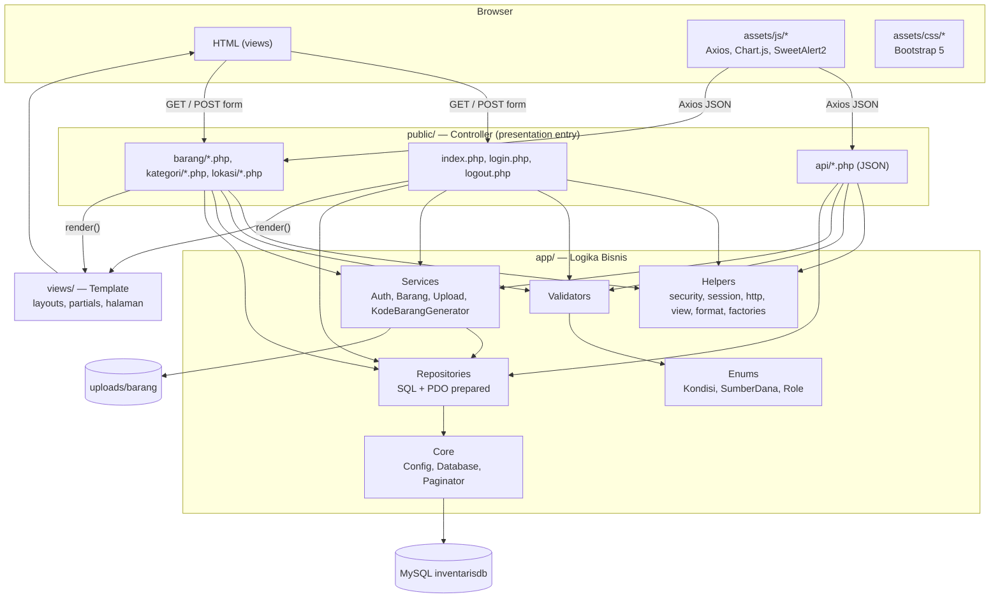

Aturan dependensi: panah hanya ke bawah. `views/` tidak boleh memanggil `app/Repositories`.

## 3. Struktur Folder Final

```text
sistem_inventaris/
├── AGENTS.md / CLAUDE.md          # aturan agent
├── README.md                      # panduan menjalankan (Fase 6)
├── .htaccess                      # rewrite semua request → public/
├── .gitignore
├── composer.json, phpunit.xml     # PHPUnit (dev)
├── package.json, playwright.config.js
├── app/                           # LOGIKA BISNIS (namespace App\)
│   ├── bootstrap.php              # autoload, config, error handler, session, helper
│   ├── Core/        Config.php · Database.php · Paginator.php
│   ├── Enums/       Kondisi.php · SumberDana.php · Role.php
│   ├── Helpers/     security.php · session.php · http.php · view.php · format.php · factories.php
│   ├── Repositories/ UserRepository · LoginAttemptRepository · KategoriRepository
│   │                 LokasiRepository · BarangRepository · DashboardRepository
│   ├── Services/    AuthResult · AuthService · KategoriService · LokasiService
│   │                UploadService · KodeBarangGenerator · BarangService
│   └── Validators/  ValidationResult · ReadsInput (trait) · KategoriValidator · LokasiValidator · BarangValidator
├── config/          config.example.php · config.php (gitignored)
├── database/        inventarisdb.sql  ← MODEL DATABASE NATIVE
├── docs/            PRD, infrastruktur, arsitektur, database, plans/
├── public/                        # DOCUMENT ROOT
│   ├── .htaccess
│   ├── index.php                  # Dashboard
│   ├── login.php · logout.php
│   ├── api/         dashboard-stats.php · kode-barang.php
│   ├── barang/      index.php · tambah.php · edit.php · detail.php · hapus.php
│   ├── kategori/    index.php · tambah.php · edit.php · hapus.php
│   ├── lokasi/      index.php · tambah.php · edit.php · hapus.php
│   ├── assets/
│   │   ├── css/     app.css · dashboard.css
│   │   ├── js/      app.js · form-validation.js · confirm-delete.js · barang-form.js · dashboard.js
│   │   ├── img/     logo.svg · hero-inventaris.svg · no-image.svg · empty-state.svg
│   │   └── vendor/  bootstrap · bootstrap-icons · axios · chartjs · sweetalert2
│   └── uploads/barang/  .htaccess · .gitkeep
├── scripts/         copy-vendor.mjs
├── storage/logs/    .gitkeep (app.log)
├── tests/
│   ├── bootstrap.php
│   ├── Support/     TestDatabase.php · reset-db.php · Fixtures.php
│   ├── Unit/        Core · Enums · Helpers · Validators · Services
│   ├── Integration/ DatabaseTestCase.php · Repositories · Services
│   └── e2e/         global-setup.js · helpers.js · *.spec.js · fixtures/
└── views/                         # PRESENTASI
    ├── layouts/     app.php · auth.php
    ├── partials/    navbar · flash · footer · page-header · pagination · empty-state · form-error-summary
    ├── auth/        login.php
    ├── dashboard/   index.php
    ├── barang/      index.php · form.php · detail.php
    ├── kategori/    index.php · form.php
    ├── lokasi/      index.php · form.php
    └── errors/      error.php
```

## 4. Siklus Request

### 4.1 Halaman GET (contoh: daftar barang)

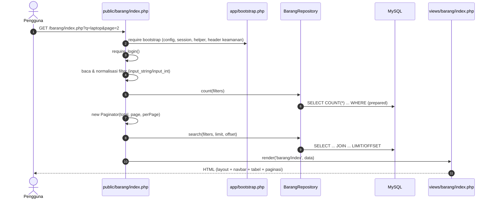

### 4.2 Form POST (pola GET-form / POST-proses / Redirect)

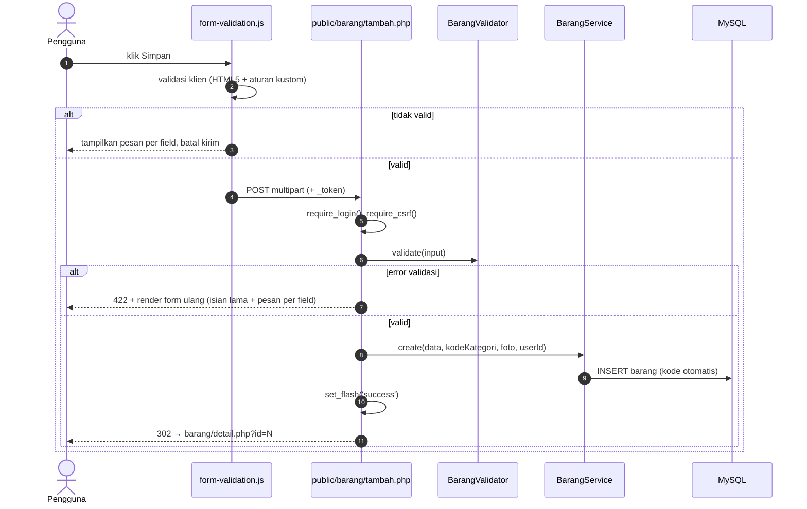

### 4.3 AJAX (contoh: hapus barang)

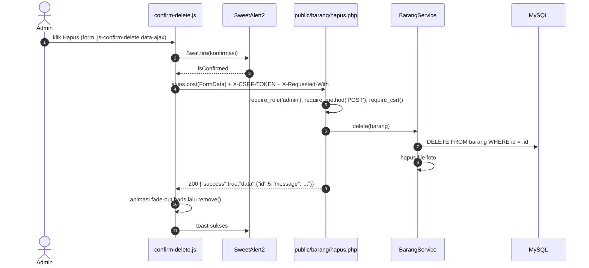

## 5. Use Case

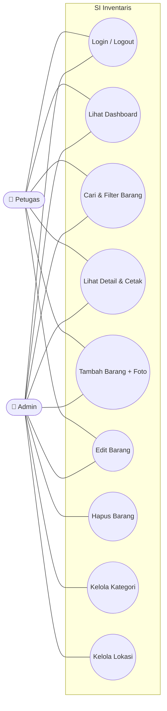

## 6. Flowchart Fitur

### 6.1 Login dengan pembatasan percobaan

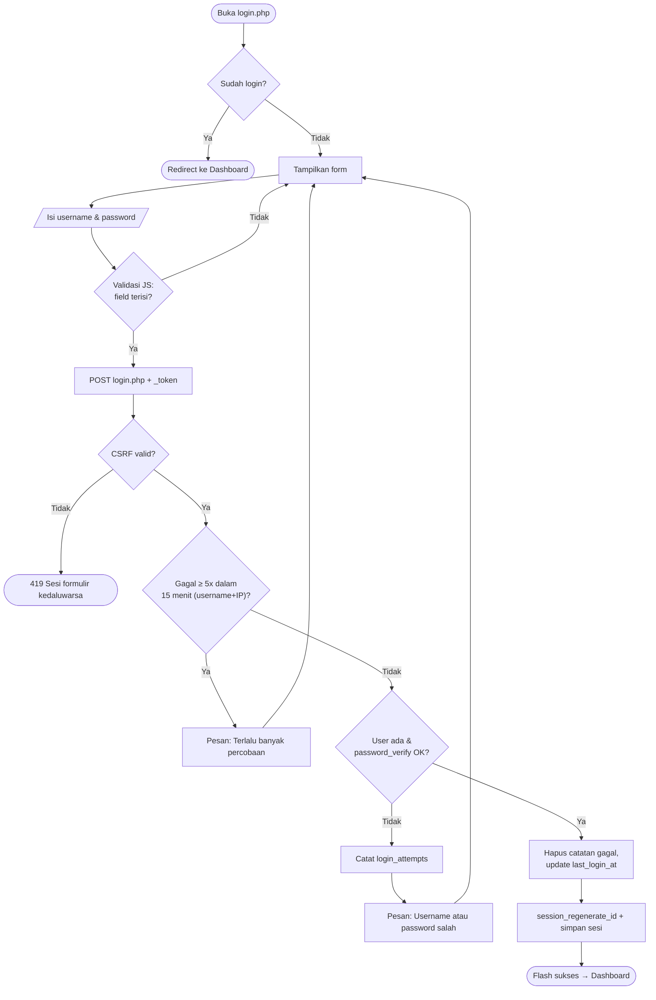

### 6.2 Tambah / Edit Barang

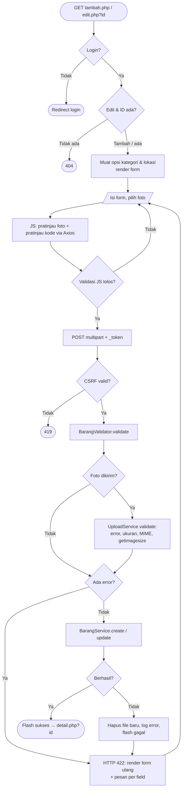

### 6.3 Pembuatan Kode Barang Otomatis

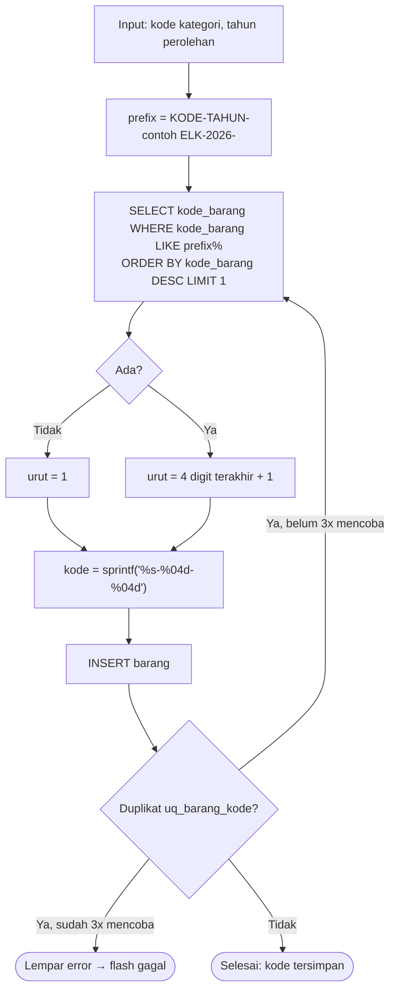

### 6.4 Hapus Barang (AJAX) & Hapus Master (form biasa)

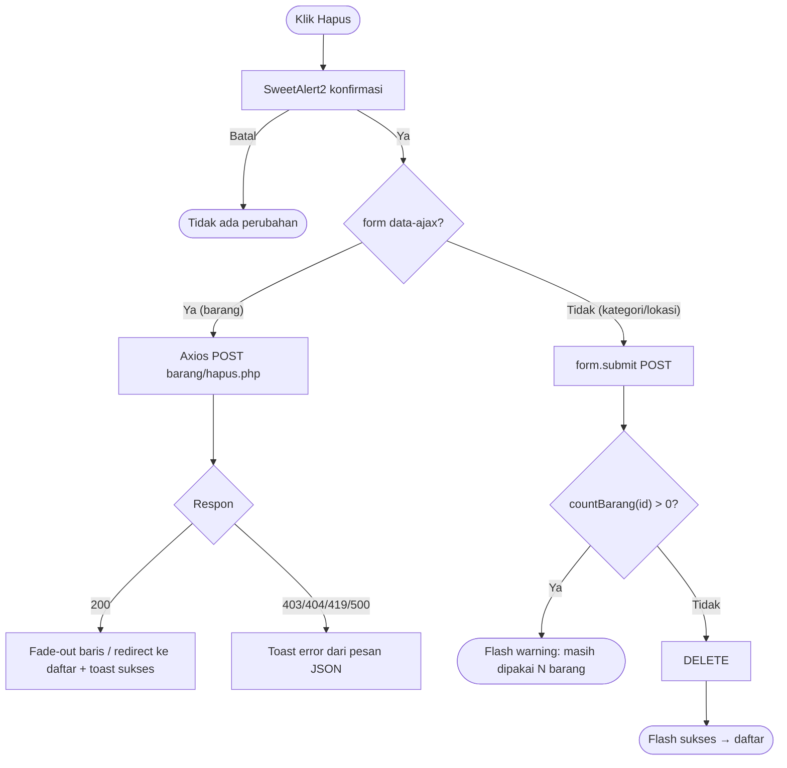

### 6.5 Upload Foto

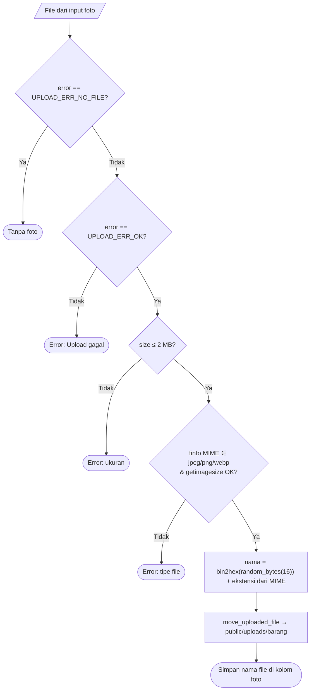

### 6.6 Dashboard

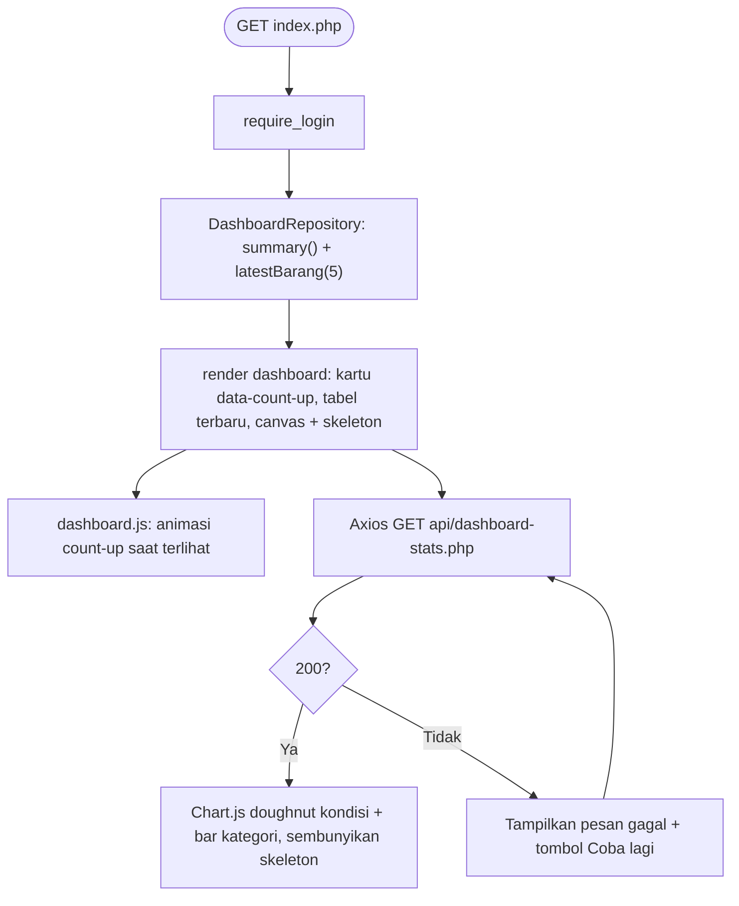

## 7. Peta Navigasi (Sitemap)

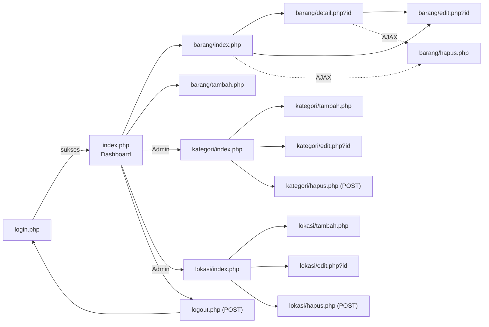

## 8. Wireframe Low-Fidelity

```text
DASHBOARD (desktop ≥ 992px)                         DASHBOARD (mobile 375px)
┌──────────────────────────────────────────────┐   ┌───────────────────┐
│ [logo] SI Inventaris  Dashboard Barang Master▾ │   │ [logo] SI Inv  [≡]│
│                                  [Nama ▾]     │   ├───────────────────┤
├──────────────────────────────────────────────┤   │ Halo, Admin! [img]│
│ ┌ Banner: Halo, Admin! ─────────── [ilustrasi]┐│   │ [+ Tambah Barang] │
│ │ Senin, 13 Oktober 2026  [+Tambah] [Data]    ││   ├───────────────────┤
│ └─────────────────────────────────────────────┘│   │ [ikon] Jenis   15 │
│ [ikon Jenis 15][ikon Unit 199][ikon Rp][Rusak] │   │ [ikon] Unit   199 │
│ ┌ Kondisi (doughnut) ┐ ┌ Per kategori (bar) ──┐│   │ [ikon] Nilai Rp.. │
│ │      ( ◔ )         │ │ ▇ ▅ ▂ ▃ ▆            ││   │ [ikon] Rusak   46 │
│ └────────────────────┘ └──────────────────────┘│   │ [doughnut]        │
│ ┌ 5 Barang Terbaru ─────────────── [Lihat]  ──┐│   │ [bar]             │
│ │ [img] ELK-2025-0001 Access Point  [Baik]    ││   │ [tabel scroll →]  │
│ └─────────────────────────────────────────────┘│   └───────────────────┘
└──────────────────────────────────────────────┘

DAFTAR BARANG                                      FORM TAMBAH/EDIT BARANG
┌──────────────────────────────────────────────┐   ┌──────────────────────────────────────┐
│ [ikon] Data Barang              [+ Tambah]    │   │ Tambah Barang     Kode: [ELK-2026-0001]│
│ ┌ [cari...] [Kategori▾][Lokasi▾][Kondisi▾][Cari]│ │ Nama*        [....................]   │
│ └──────────────────────────────────────────────┘│ │ Kategori* [▾]        Lokasi* [▾]      │
│ No Foto Kode       Nama      Kat  Lok  Jml Kond Aksi│ Merk  [....]  Jumlah* [1] Satuan*[▾]│
│ 1  [▣] ELK-..-0001 Komputer  Elk  Lab  30 [Baik][👁][✎][🗑]│ Kondisi* [▾] Sumber dana* [▾]   │
│ ...                                            │   │ Tgl perolehan* [date] Harga [Rp...]   │
│ Menampilkan 1–10 dari 15       « 1 [2] »      │   │ Keterangan [..........] 0/1000        │
└──────────────────────────────────────────────┘   │ Foto [pilih] [pratinjau]  □ Hapus foto│
                                                   │                  [Batal] [💾 Simpan]  │
DETAIL BARANG                                      └──────────────────────────────────────┘
┌──────────────────────────────────────────────┐
│ Data Barang › ELK-2023-0001                   │
│ ┌ [FOTO besar] ┐ ┌ Komputer PC Desktop [Baik]┐│
│ │              │ │ Kategori · Lokasi · Merk  ││
│ │              │ │ Jumlah · Harga · Total    ││
│ └──────────────┘ │ Sumber dana · Tgl         ││
│                  │ Dibuat oleh .. pada ..    ││
│ [✎ Edit] [🖨 Cetak] [🗑 Hapus]               ││
└──────────────────────────────────────────────┘
```

## 9. Kontrak AJAX (JSON)

Format respons seragam:

```json
{ "success": true,  "data": { } }
{ "success": false, "error": "Pesan untuk pengguna", "errors": { "field": "pesan" } }
```

Header request (otomatis dari `InvApp.http` di `app.js`): `X-Requested-With: XMLHttpRequest`,
`X-CSRF-TOKEN: <token>`, `Accept: application/json`. Sesi habis → **401**; tanpa hak → **403**.

| # | Method & URL | Akses | Request | Respons sukses (200) | Error |
|---|---|---|---|---|---|
| A1 | `GET api/dashboard-stats.php` | Login | — | `{"success":true,"data":{"kondisi":{"labels":["Baik","Rusak Ringan","Rusak Berat"],"values":[153,38,8],"colors":["#198754","#f59e0b","#dc3545"]},"kategori":{"labels":["Mebel","Elektronik",...],"values":[75,43,...]}}}` | 401 |
| A2 | `GET api/kode-barang.php?kategori_id=1&tanggal=2026-10-13` | Login | query | `{"success":true,"data":{"kode":"ELK-2026-0001"}}` | 401, 422 `{"success":false,"error":"Kategori tidak valid."}` |
| A3 | `POST barang/hapus.php` | Admin | form `id`, `_token` | `{"success":true,"data":{"id":5,"message":"Barang \"Proyektor LCD\" berhasil dihapus."}}` | 401, 403, 404, 405, 419, 500 |

`barang/hapus.php` juga melayani request non-AJAX (fallback tanpa JS): flash + redirect ke daftar.

## 10. Status HTTP & Penanganan Error

| Status | Kapan | Respons HTML | Respons AJAX |
|---|---|---|---|
| 200 | Sukses | Halaman | `success:true` |
| 302 | Setelah POST sukses (PRG), belum login | Redirect + flash | — (AJAX belum login → 401) |
| 401 | AJAX tanpa sesi | — | `Sesi Anda berakhir. Silakan login kembali.` |
| 403 | Role tidak cukup | `errors/error` | JSON error |
| 404 | ID tidak ditemukan | `errors/error` | JSON error |
| 405 | Method salah (GET ke `hapus.php`) | `errors/error` | JSON error |
| 419 | Token CSRF tidak valid | `errors/error` | JSON error |
| 422 | Validasi server gagal | Form dirender ulang + pesan per field | JSON `errors` |
| 500 | Exception tak tertangani | `errors/error` (pesan generik jika `debug=false`) | JSON error |

Semua exception tak tertangani ditangkap `set_exception_handler` di `app/bootstrap.php` → `error_log()` → `abort(500)`.

## 11. Template Controller Baku

```php
<?php
declare(strict_types=1);

use App\Core\Database;
use App\Repositories\KategoriRepository;

require dirname(__DIR__, 2) . '/app/bootstrap.php';   // file di public/ langsung: dirname(__DIR__)

// 1. Guard
require_role('admin');

// 2. Dependensi
$repo = new KategoriRepository(Database::connection());

// 3. Input
$id = input_int($_GET, 'id');

// 4. Proses (validator / service / repository)
$kategori = $id ? $repo->find($id) : null;
if ($kategori === null) {
    abort(404, 'Kategori tidak ditemukan.');
}

// 5. Output
render('kategori/form', [
    'pageTitle' => 'Edit Kategori',
    'kategori'  => $kategori,
    'errors'    => [],
]);
```

## 12. Katalog API Internal (WAJIB konsisten)

### 12.1 Helper global (`app/Helpers/*.php`)

| File | Signature | Fungsi |
|---|---|---|
| security | `e(mixed $value): string` | Escape HTML (`htmlspecialchars` ENT_QUOTES, UTF-8) |
| security | `csrf_token(): string` / `csrf_field(): string` | Token sesi / `<input type="hidden" name="_token">` |
| security | `verify_csrf(?string $token): bool` / `require_csrf(): void` | Cek token (`hash_equals`) / abort 419 |
| security | `like_escape(string $value): string` | Escape `\`, `%`, `_` untuk LIKE |
| security | `client_ip(): string` / `send_security_headers(): void` | IP klien / header CSP dkk |
| session | `start_secure_session(): void` | Cookie HttpOnly, SameSite=Lax, strict mode |
| session | `set_flash(string $type, string $message, ?string $title = null): void` / `get_flash(): ?array` | Notifikasi sekali tampil |
| session | `login_user(array $user): void` / `logout_user(): void` | Simpan/bersihkan sesi + regenerasi ID |
| session | `current_user(): ?array` / `current_user_id(): ?int` / `is_logged_in(): bool` | Info sesi |
| session | `has_role(string ...$roles): bool` / `is_admin(): bool` / `require_login(): void` / `require_role(string ...$roles): void` | Otorisasi |
| http | `config(string $key, mixed $default = null): mixed` | Baca konfigurasi `a.b.c` |
| http | `url(string $path = '', array $query = []): string` / `asset(string $path): string` | URL absolut dari `app.base_url` |
| http | `upload_url(?string $filename): string` | URL foto atau placeholder `img/no-image.svg` |
| http | `redirect(string $path, array $query = []): never` | Redirect + exit |
| http | `is_post(): bool` / `is_ajax(): bool` / `require_method(string $method): void` | Info request |
| http | `input_string(array $src, string $key): string` / `input_int(array $src, string $key): ?int` | Ambil input ter-trim / int valid |
| http | `current_path(): string` / `nav_active(string ...$prefixes): string` | Menu aktif (`' active'`) |
| http | `json_success(array $data = [], int $status = 200): never` / `json_error(string $message, int $status = 400, array $errors = []): never` / `send_json(array $payload, int $status): never` | Respons JSON |
| http | `abort(int $status, string $message = ''): never` | Halaman/JSON error |
| view | `render(string $view, array $data = [], string $layout = 'app'): void` | Render view dalam layout |
| view | `render_to_string(string $view, array $data = []): string` / `partial(string $name, array $data = []): void` | Render tanpa layout / partial |
| view | `invalid_class(array $errors, string $field): string` | `' is-invalid'` bila ada error |
| view | `selected(mixed $current, mixed $value): string` / `checked(bool $condition): string` | Atribut form |
| format | `format_rupiah(int\|float\|string\|null $amount): string` | `Rp 1.500.000` |
| format | `format_angka(int\|float\|string\|null $number): string` | `1.500` |
| format | `format_tanggal(?string $date, bool $withTime = false): string` | `13 Oktober 2026[, 14:05 WIB]` |
| format | `format_tanggal_lengkap(?string $date): string` | `Selasa, 13 Oktober 2026` |
| format | `str_limit(?string $text, int $limit = 60): string` | Potong teks + `…` |
| factories | `make_auth_service()`, `make_upload_service()`, `make_kode_generator()`, `make_barang_service()` | Merakit service + dependensi |

### 12.2 Class

| Class | API publik |
|---|---|
| `App\Core\Config` | `static load(array $config): void`, `static all(): array`, `static get(string $key, mixed $default = null): mixed` |
| `App\Core\Database` | `static connection(): PDO`, `static create(array $db, bool $withDatabase = true): PDO`, `static disconnect(): void` |
| `App\Core\Paginator` | `__construct(int $total, int $page, int $perPage)`; props readonly `total, page, perPage, totalPages`; `offset()`, `from()`, `to()`, `hasPrevious()`, `hasNext()`, `pages(int $window = 2): array` |
| `App\Enums\HasOptions` (trait) | `static options(): array<string,string>` (value ⇒ label) untuk enum yang punya `label()` |
| `App\Enums\Kondisi` | cases `Baik, RusakRingan, RusakBerat`; `label()`, `badgeClass()`, `color()`, `static options()` |
| `App\Enums\SumberDana` | cases `BOS, APBD, Komite, Hibah, Lainnya`; `label()`, `static options()` |
| `App\Enums\Role` | cases `Admin, Petugas`; `label()` |
| `App\Validators\ValidationResult` | `__construct(array $data, array $errors = [])`, `isValid(): bool`, `withError(string $field, string $message): self` |
| `App\Validators\ReadsInput` (trait) | `text()`, `nullableText()`, `upperText()`, `intOrNull()`, `lengthBetween()` (private static) |
| `App\Validators\KategoriValidator` | `validate(array $input): ValidationResult` |
| `App\Validators\LokasiValidator` | `validate(array $input): ValidationResult`, const `MSG_KODE` |
| `App\Validators\BarangValidator` | `__construct(array $kategoriIds, array $lokasiIds, ?DateTimeImmutable $today = null)`, `validate(array $input): ValidationResult`, const `SATUAN`, `MESSAGES`, `JUMLAH_MAX`, `HARGA_MAX`, `TANGGAL_MIN` |
| `App\Repositories\UserRepository` | `findByUsername(string)`, `findById(int)`, `touchLastLogin(int)`, `updatePasswordHash(int, string)` |
| `App\Repositories\LoginAttemptRepository` | `countRecent(string $username, string $ip, int $minutes): int`, `record(...)`, `clear(...)` |
| `App\Repositories\KategoriRepository` | `all()`, `find(int)`, `options()`, `existsKode(string, ?int)`, `existsNama(string, ?int)`, `create(array): int`, `update(int, array)`, `delete(int)`, `countBarang(int): int` |
| `App\Repositories\LokasiRepository` | `all()`, `find(int)`, `options()`, `existsKode(string, ?int)`, `create(array): int`, `update(int, array)`, `delete(int)`, `countBarang(int): int` |
| `App\Repositories\BarangRepository` | `search(array $filters, int $limit, int $offset): array`, `count(array $filters): int`, `find(int)`, `create(array $data, int $userId): int`, `update(int $id, array $data, int $userId)`, `delete(int)`, `lastKodeWithPrefix(string $prefix): ?string` |
| `App\Repositories\DashboardRepository` | `summary(): array`, `unitPerKondisi(): array`, `unitPerKategori(): array`, `latestBarang(int $limit = 5): array` |
| `App\Services\AuthResult` | `static success(array $user)`, `static failed(string $message)`; readonly `ok`, `user`, `message` |
| `App\Services\AuthService` | `attempt(string $username, string $password, string $ip): AuthResult`, const `MSG_INVALID` |
| `App\Services\KategoriService` | `__construct(KategoriRepository, KategoriValidator = new)`, `save(array $input, ?int $id = null): ValidationResult` (data berisi `id` bila sukses), `delete(int $id): ?string` (pesan penolakan / null) |
| `App\Services\LokasiService` | sama dengan `KategoriService` untuk lokasi |
| `App\Services\UploadService` | `__construct(string $dir, int $maxBytes, array $mimes, ?Closure $mover = null)`, `isProvided(?array $file): bool`, `validate(array $file): ?string`, `store(array $file): string`, `delete(?string $filename): void`, const `MSG_INVALID`, `MSG_FAILED` |
| `App\Services\KodeBarangGenerator` | `static format(string $kode, int $tahun, int $urut): string`, `static nextSequence(?string $lastKode): int`, `next(string $kategoriKode, int $tahun): string` |
| `App\Services\BarangService` | `validate(BarangValidator $v, array $input, ?array $foto): ValidationResult`, `create(array $data, string $kategoriKode, ?array $foto, int $userId): array{id,kode_barang}`, `update(array $existing, array $data, ?array $foto, bool $hapusFoto, int $userId): void`, `delete(array $barang): void` |

### 12.3 Partial view (`views/partials/*.php`)

| Partial | Variabel | Keterangan |
|---|---|---|
| `navbar` | `$user` | Navbar responsif, menu Master Data hanya Admin, form logout POST |
| `flash` | — | Alert dari `get_flash()`, kelas `js-auto-dismiss` |
| `footer` | — | Footer |
| `page-header` | `$title`, `$subtitle`, `$icon`, `$actions` (array `url,label,icon,class`) | Judul halaman + tombol aksi |
| `pagination` | `$paginator`, `$path`, `$query` | Navigasi halaman mempertahankan filter |
| `empty-state` | `$title`, `$message`, `$actionUrl?`, `$actionLabel?` | Ilustrasi + pesan kosong |
| `form-error-summary` | `$errors` | Ringkasan error (`role="alert"`) di atas form |

### 12.4 Modul JavaScript (`public/assets/js/*.js`)

| File | Dimuat di | Global/Hook | Fungsi |
|---|---|---|---|
| `app.js` | semua halaman | `window.InvApp = { http, toast, errorMessage, csrfToken }`; `.js-auto-dismiss`, `[data-char-counter]`, `[data-action="print"]`, `[data-toggle-password]` | Instance Axios ber-CSRF, toast SweetAlert2 (`titleText`, aman XSS), auto-dismiss alert, penghitung karakter, cetak, toggle password |
| `form-validation.js` | semua halaman | `form.js-validate`; atribut `required, minlength, maxlength, min, max, pattern, data-rule-not-future, data-max-size, data-allowed-types, data-msg` | Validasi klien generik, pesan Bahasa Indonesia |
| `confirm-delete.js` | semua halaman | `form.js-confirm-delete[data-item-name][data-ajax][data-redirect]` | Konfirmasi SweetAlert2, hapus AJAX + animasi |
| `barang-form.js` | tambah/edit barang | `#foto`, `[data-foto-preview]`, `[data-kode-preview][data-kode-url]`, `#hapus_foto` | Pratinjau foto, pratinjau kode (Axios) |
| `dashboard.js` | dashboard | `[data-stats-url]`, `[data-count-up]`, `#chartKondisi`, `#chartKategori`, `[data-chart-skeleton]`, `[data-chart-error]`, `[data-chart-retry]` | Count-up saat terlihat (IntersectionObserver), ambil statistik (Axios), render Chart.js, skeleton & coba lagi |
