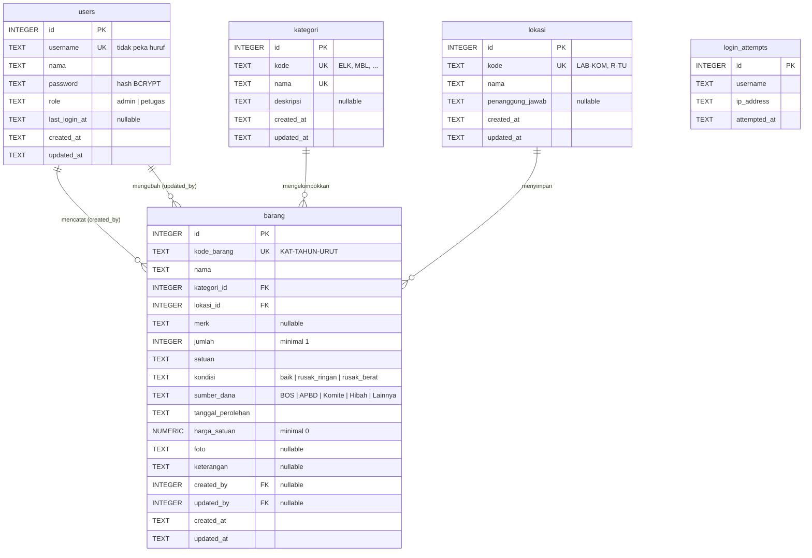

# Desain Database: SI Inventaris Sekolah

> **Database = satu file SQLite** `storage/database/inventaris.sqlite`. Tidak ada server database yang perlu dijalankan.
> Skema dan data awal ada di `database/inventarisdb.sql` (sumber kebenaran). File dibuat dengan `php scripts/init-db.php`.

| Item | Nilai |
|---|---|
| Engine | SQLite 3 lewat PDO (`sqlite:`), bawaan PHP 8.2+ |
| File dev | `storage/database/inventaris.sqlite` |
| File test | `storage/database/inventaris_test.sqlite` (dikosongkan dan dibuat ulang otomatis oleh test) |
| Kunci asing | Aktif untuk setiap koneksi (`PRAGMA foreign_keys = ON`) |
| Batas tunggu kunci | 5 detik (`PRAGMA busy_timeout = 5000`) |
| Tipe waktu | `TEXT` berformat `YYYY-MM-DD HH:MM:SS` (waktu lokal). Default `datetime('now','localtime')`; `updated_at` diperbarui oleh trigger |
| Pencarian tidak peka huruf | Kolom kode dan nama memakai `COLLATE NOCASE`, meniru perilaku MySQL `_ci` |
| Idempoten | `CREATE ... IF NOT EXISTS`, seed `ON CONFLICT DO NOTHING`, dan foto contoh hanya mengisi kolom yang masih kosong |

---

## 1. ERD



`login_attempts` sengaja tidak punya FK ke `users`, karena juga mencatat username yang tidak terdaftar.

## 2. Kamus Data

### 2.1 `users`
| Kolom | Tipe | Null | Default | Constraint | Keterangan |
|---|---|:-:|---|---|---|
| id | INTEGER | tidak | autoincrement | PK | |
| username | TEXT COLLATE NOCASE | tidak | | `uq_users_username` | Login, tidak peka huruf besar-kecil |
| nama | TEXT | tidak | | | Nama tampilan |
| password | TEXT | tidak | | | Hash BCRYPT dari `password_hash()` |
| role | TEXT | tidak | `petugas` | `chk_users_role` (admin, petugas) | Hak akses, lihat PRD §9 |
| last_login_at | TEXT | ya | NULL | | Diperbarui saat login berhasil |
| created_at / updated_at | TEXT | tidak | `datetime('now','localtime')` | | `updated_at` diperbarui trigger `trg_users_updated_at` |

### 2.2 `kategori`
| Kolom | Tipe | Null | Default | Constraint | Keterangan |
|---|---|:-:|---|---|---|
| id | INTEGER | tidak | autoincrement | PK | |
| kode | TEXT COLLATE NOCASE | tidak | | `uq_kategori_kode` | 3 huruf, awalan kode barang |
| nama | TEXT COLLATE NOCASE | tidak | | `uq_kategori_nama` | |
| deskripsi | TEXT | ya | NULL | | |
| created_at / updated_at | TEXT | tidak | `datetime('now','localtime')` | | Trigger `trg_kategori_updated_at` |

### 2.3 `lokasi`
| Kolom | Tipe | Null | Default | Constraint | Keterangan |
|---|---|:-:|---|---|---|
| id | INTEGER | tidak | autoincrement | PK | |
| kode | TEXT COLLATE NOCASE | tidak | | `uq_lokasi_kode` | Contoh: LAB-KOM, R-7A |
| nama | TEXT | tidak | | | Nama ruangan |
| penanggung_jawab | TEXT | ya | NULL | | |
| created_at / updated_at | TEXT | tidak | `datetime('now','localtime')` | | Trigger `trg_lokasi_updated_at` |

### 2.4 `barang`
| Kolom | Tipe | Null | Default | Constraint | Keterangan |
|---|---|:-:|---|---|---|
| id | INTEGER | tidak | autoincrement | PK | |
| kode_barang | TEXT COLLATE NOCASE | tidak | | `uq_barang_kode` | `KAT-YYYY-NNNN`, tidak pernah berubah (BR-01/02) |
| nama | TEXT | tidak | | | Dicari dengan `LIKE`, ada indeks `idx_barang_nama` |
| kategori_id | INTEGER | tidak | | `fk_barang_kategori` ke kategori (UPDATE CASCADE, DELETE RESTRICT) | Indeks `idx_barang_kategori` |
| lokasi_id | INTEGER | tidak | | `fk_barang_lokasi` ke lokasi (UPDATE CASCADE, DELETE RESTRICT) | Indeks `idx_barang_lokasi` |
| merk | TEXT | ya | NULL | | |
| jumlah | INTEGER | tidak | 1 | `chk_barang_jumlah` (minimal 1) | Validasi aplikasi: 1 sampai 100.000 |
| satuan | TEXT | tidak | `unit` | | Daftar ada di `BarangValidator::SATUAN` |
| kondisi | TEXT | tidak | `baik` | `chk_barang_kondisi` | `App\Enums\Kondisi` |
| sumber_dana | TEXT | tidak | `BOS` | `chk_barang_sumber_dana` | `App\Enums\SumberDana` |
| tanggal_perolehan | TEXT | tidak | | | `YYYY-MM-DD`, 1990-01-01 sampai hari ini; tahunnya dipakai untuk kode barang |
| harga_satuan | NUMERIC | tidak | 0 | `chk_barang_harga` (minimal 0) | Validasi aplikasi: maksimal 1.000.000.000 |
| foto | TEXT | ya | NULL | | Nama file (32 karakter hex + ekstensi) di `public/uploads/barang/`, atau `sample-*.png` untuk foto contoh |
| keterangan | TEXT | ya | NULL | | Maksimal 1.000 karakter (aplikasi) |
| created_by / updated_by | INTEGER | ya | NULL | `fk_barang_created_by`, `fk_barang_updated_by` ke users (DELETE SET NULL) | Pencatat dan pengubah terakhir |
| created_at / updated_at | TEXT | tidak | `datetime('now','localtime')` | | Trigger `trg_barang_updated_at` |

### 2.5 `login_attempts`
| Kolom | Tipe | Null | Default | Constraint | Keterangan |
|---|---|:-:|---|---|---|
| id | INTEGER | tidak | autoincrement | PK | |
| username | TEXT COLLATE NOCASE | tidak | | | |
| ip_address | TEXT | tidak | | `idx_login_attempts_lookup` (username, ip_address, attempted_at) | Muat IPv6 |
| attempted_at | TEXT | tidak | `datetime('now','localtime')` | | Jendela 15 menit |

## 3. Pemetaan dari MySQL (sudah dilakukan)

| MySQL (versi awal) | SQLite (sekarang) |
|---|---|
| `INT UNSIGNED AUTO_INCREMENT` | `INTEGER PRIMARY KEY AUTOINCREMENT` |
| `ENUM('a','b')` | `TEXT` dengan `CHECK (kolom IN ('a','b'))` |
| `DATETIME DEFAULT CURRENT_TIMESTAMP ON UPDATE CURRENT_TIMESTAMP` | `TEXT DEFAULT (datetime('now','localtime'))` dan trigger `AFTER UPDATE` |
| `DECIMAL(15,2)` | `NUMERIC` |
| `CHAR(3)`, `VARCHAR(n)` | `TEXT` |
| Kolom kode/nama (collation `_ci`) | `TEXT COLLATE NOCASE` |
| `ON DUPLICATE KEY UPDATE id = id` | `ON CONFLICT DO NOTHING` |
| `NOW()`, `NOW() - INTERVAL n MINUTE` | `datetime('now','localtime')`, `datetime('now','localtime','-n minutes')` |
| `LIKE :q` (escape default `\`) | `LIKE :q ESCAPE '\'` |
| `CHAR_LENGTH(x)` | `length(x)` |
| `COMMENT '...'` | Dihapus dari skema; penjelasan ada di dokumen ini |
| `SHOW TABLES` | `SELECT name FROM sqlite_master WHERE type = 'table'` |
| `SET time_zone` per koneksi | Tidak diperlukan; waktu disimpan dalam waktu lokal |

## 4. Query kunci

```sql
-- Daftar barang + filter (BarangRepository::search); parameter selalu prepared
SELECT b.id, b.kode_barang, b.nama, b.merk, b.jumlah, b.satuan, b.kondisi, b.foto,
       k.nama AS kategori_nama, l.nama AS lokasi_nama
FROM barang b
JOIN kategori k ON k.id = b.kategori_id
JOIN lokasi   l ON l.id = b.lokasi_id
WHERE (b.nama LIKE :q1 ESCAPE '\' OR b.kode_barang LIKE :q2 ESCAPE '\' OR b.merk LIKE :q3 ESCAPE '\')
  AND b.kategori_id = :kategori_id AND b.lokasi_id = :lokasi_id AND b.kondisi = :kondisi
ORDER BY b.created_at DESC, b.id DESC
LIMIT :limit OFFSET :offset;

-- Ringkasan dashboard (DashboardRepository::summary)
SELECT COUNT(*) AS total_jenis,
       COALESCE(SUM(jumlah), 0) AS total_unit,
       COALESCE(SUM(jumlah * harga_satuan), 0) AS total_nilai,
       COALESCE(SUM(CASE WHEN kondisi <> 'baik' THEN jumlah ELSE 0 END), 0) AS total_rusak
FROM barang;

-- Kode terakhir per prefix (BarangRepository::lastKodeWithPrefix)
SELECT kode_barang FROM barang
WHERE kode_barang LIKE :prefix ESCAPE '\'
ORDER BY length(kode_barang) DESC, kode_barang DESC
LIMIT 1;

-- Rate limit login (LoginAttemptRepository::countRecent)
SELECT COUNT(*) FROM login_attempts
WHERE username = :username AND ip_address = :ip
  AND attempted_at >= datetime('now', 'localtime', '-' || :minutes || ' minutes');
```

## 5. Data seed dan angka acuan test

Akun default (**ganti sebelum dipakai di server sekolah**):

| id | username | password | role |
|---|---|---|---|
| 1 | `admin` | `admin123` | admin |
| 2 | `petugas` | `petugas123` | petugas |

Master: 5 kategori (`ELK` Elektronik, `MBL` Mebel, `ATK` Alat Tulis Kantor, `OLR` Alat Olahraga, `LAB` Alat Laboratorium) dan 6 lokasi (`LAB-KOM`, `R-TU`, `R-GURU`, `GDG-OR`, `LAB-IPA`, `R-7A`).

Foto contoh: 15 ilustrasi `public/uploads/barang/sample-*.png`, satu per barang seed. Ini bukan foto asli. `UPDATE` di seed hanya mengisi kolom `foto` yang masih kosong. Ganti dengan foto asli lewat menu Edit barang.

Angka berikut dihitung dari seed dan dipakai sebagai nilai acuan di test integration dan E2E:

| Metrik | Nilai |
|---|---|
| Jumlah jenis barang | **15** |
| Total unit | **199** |
| Total nilai aset | **Rp 473.150.000** |
| Unit kondisi baik / rusak ringan / rusak berat | **153 / 38 / 8** |
| Total unit rusak | **46** |
| Unit per kategori ELK / MBL / ATK / OLR / LAB | **43 / 75 / 35 / 12 / 34** |
| Jumlah barang per lokasi LAB-KOM / R-TU / R-GURU / GDG-OR / LAB-IPA / R-7A | **3 / 3 / 2 / 2 / 3 / 2** |
| Kode berikutnya `ELK` tahun 2024 | `ELK-2024-0003` |
| Kode berikutnya `ELK` tahun 2026 | `ELK-2026-0001` |
| 5 barang terbaru | Gelas Ukur 100 ml, Mikroskop Binokuler, Kit Praktikum Kelistrikan, Net Bola Voli, Bola Sepak |

## 6. Prosedur

| Tugas | Cara |
|---|---|
| Buat atau lengkapi database dev | `php scripts/init-db.php`. Aman dijalankan ulang, data yang ada tidak berubah |
| Reset database test | Otomatis oleh `TestDatabase::reset()`: tabel dikosongkan lalu dibuat ulang dari `database/inventarisdb.sql`. Hanya file `*_test.sqlite` yang boleh |
| Ubah skema | Edit `database/inventarisdb.sql` (gunakan `IF NOT EXISTS`), lalu perbarui bagian 2 dan 3 dokumen ini. Untuk database yang sudah ada, tulis `ALTER TABLE` manual sekali jalan (tanpa migration tool, sesuai AGENTS.md) |
| Backup | Salin `storage/database/inventaris.sqlite` saat aplikasi tidak sedang menulis, dan salin juga `public/uploads/barang/`. Lihat `02-INFRASTRUKTUR.md` §9 |
| Pindah ke server | Salin file `.sqlite` bersama folder proyek. Pastikan user web server bisa menulis di `storage/database/` (SQLite juga menulis file jurnal di folder yang sama) |

**Migrasi dari MySQL:** database dev MySQL `inventarisdb` (Laragon) dibiarkan sebagai arsip. Isinya sama dengan seed (15 barang, 2 user, 5 kategori, 6 lokasi), jadi file SQLite dibuat ulang dari seed. Jika kelak ada data tambahan di MySQL, ekspor dan impor secara manual (tidak diotomasi).
