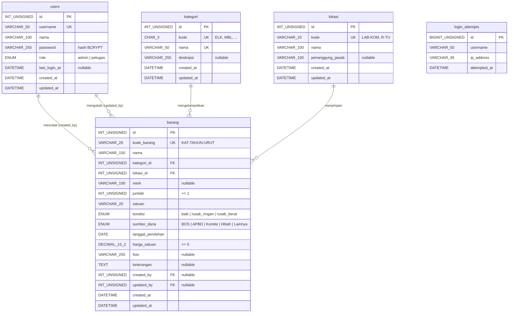

# Desain Database — SI Inventaris Sekolah

> **Model database = file SQL native `database/inventarisdb.sql`.** Tidak ada ORM, tidak ada migration
> tool. File tersebut berisi `CREATE DATABASE`, seluruh `CREATE TABLE` + constraint, dan seed.
> Setiap perubahan skema **wajib** dilakukan di file itu dan dicatat di dokumen ini.

| Item | Nilai |
|---|---|
| Nama database | `inventarisdb` (test: `inventarisdb_test`) |
| Engine / charset | InnoDB / `utf8mb4` + `utf8mb4_unicode_ci` |
| Kompatibilitas | MySQL 8.0.16+ (CHECK ditegakkan), MariaDB 10.4+ |
| Zona waktu koneksi | `+07:00` (diset PDO `MYSQL_ATTR_INIT_COMMAND`) |
| Idempoten | Ya — `CREATE TABLE IF NOT EXISTS` + `ON DUPLICATE KEY UPDATE id = id` |

---

## 1. ERD



`login_attempts` sengaja **tidak** ber-FK ke `users` karena mencatat juga username yang tidak terdaftar.

## 2. Kamus Data

### 2.1 `users`
| Kolom | Tipe | Null | Default | Constraint | Keterangan |
|---|---|:-:|---|---|---|
| id | INT UNSIGNED | – | AUTO_INCREMENT | PK | |
| username | VARCHAR(50) | – | | `uq_users_username` | Login |
| nama | VARCHAR(100) | – | | | Nama tampilan |
| password | VARCHAR(255) | – | | | `password_hash()` BCRYPT; di-rehash otomatis bila perlu |
| role | ENUM('admin','petugas') | – | `petugas` | | Hak akses (lihat PRD §9) |
| last_login_at | DATETIME | ✓ | NULL | | Diperbarui saat login sukses |
| created_at / updated_at | DATETIME | – | CURRENT_TIMESTAMP | `ON UPDATE` | |

### 2.2 `kategori`
| Kolom | Tipe | Null | Default | Constraint | Keterangan |
|---|---|:-:|---|---|---|
| id | INT UNSIGNED | – | AUTO_INCREMENT | PK | |
| kode | CHAR(3) | – | | `uq_kategori_kode` | 3 huruf kapital, prefix kode barang |
| nama | VARCHAR(50) | – | | `uq_kategori_nama` | |
| deskripsi | VARCHAR(255) | ✓ | NULL | | |
| created_at / updated_at | DATETIME | – | CURRENT_TIMESTAMP | | |

### 2.3 `lokasi`
| Kolom | Tipe | Null | Default | Constraint | Keterangan |
|---|---|:-:|---|---|---|
| id | INT UNSIGNED | – | AUTO_INCREMENT | PK | |
| kode | VARCHAR(10) | – | | `uq_lokasi_kode` | `^[A-Z0-9-]{2,10}$` |
| nama | VARCHAR(100) | – | | | Nama ruangan |
| penanggung_jawab | VARCHAR(100) | ✓ | NULL | | |
| created_at / updated_at | DATETIME | – | CURRENT_TIMESTAMP | | |

### 2.4 `barang`
| Kolom | Tipe | Null | Default | Constraint | Keterangan |
|---|---|:-:|---|---|---|
| id | INT UNSIGNED | – | AUTO_INCREMENT | PK | |
| kode_barang | VARCHAR(20) | – | | `uq_barang_kode` | `KAT-YYYY-NNNN`, immutable (BR-01/02) |
| nama | VARCHAR(150) | – | | `idx_barang_nama` | |
| kategori_id | INT UNSIGNED | – | | `fk_barang_kategori` → kategori.id (UPDATE CASCADE, DELETE RESTRICT) | |
| lokasi_id | INT UNSIGNED | – | | `fk_barang_lokasi` → lokasi.id (UPDATE CASCADE, DELETE RESTRICT) | |
| merk | VARCHAR(100) | ✓ | NULL | | |
| jumlah | INT UNSIGNED | – | 1 | `chk_barang_jumlah` (≥ 1) | Validasi aplikasi: 1–100.000 |
| satuan | VARCHAR(20) | – | `unit` | | Daftar: `BarangValidator::SATUAN` |
| kondisi | ENUM | – | `baik` | `idx_barang_kondisi` | `App\Enums\Kondisi` |
| sumber_dana | ENUM | – | `BOS` | | `App\Enums\SumberDana` |
| tanggal_perolehan | DATE | – | | | 1990-01-01 s.d. hari ini; tahun → kode barang |
| harga_satuan | DECIMAL(15,2) | – | 0.00 | `chk_barang_harga` (≥ 0) | Validasi aplikasi ≤ 1.000.000.000 |
| foto | VARCHAR(255) | ✓ | NULL | | Nama file (32 hex + ekstensi) di `public/uploads/barang/` |
| keterangan | TEXT | ✓ | NULL | | ≤ 1.000 karakter (aplikasi) |
| created_by | INT UNSIGNED | ✓ | NULL | `fk_barang_created_by` → users.id (DELETE SET NULL) | |
| updated_by | INT UNSIGNED | ✓ | NULL | `fk_barang_updated_by` → users.id (DELETE SET NULL) | |
| created_at / updated_at | DATETIME | – | CURRENT_TIMESTAMP | `ON UPDATE` | |

### 2.5 `login_attempts`
| Kolom | Tipe | Null | Default | Constraint | Keterangan |
|---|---|:-:|---|---|---|
| id | BIGINT UNSIGNED | – | AUTO_INCREMENT | PK | |
| username | VARCHAR(50) | – | | `idx_login_attempts_lookup` (username, ip_address, attempted_at) | |
| ip_address | VARCHAR(45) | – | | | Muat IPv6 |
| attempted_at | DATETIME | – | CURRENT_TIMESTAMP | | Jendela 15 menit |

## 3. Query Kunci (diimplementasikan di Repository)

```sql
-- Daftar barang + filter (BarangRepository::search) — parameter selalu prepared
SELECT b.id, b.kode_barang, b.nama, b.merk, b.jumlah, b.satuan, b.kondisi, b.foto,
       k.nama AS kategori_nama, l.nama AS lokasi_nama
FROM barang b
JOIN kategori k ON k.id = b.kategori_id
JOIN lokasi   l ON l.id = b.lokasi_id
WHERE (b.nama LIKE :q1 OR b.kode_barang LIKE :q2 OR b.merk LIKE :q3)
  AND b.kategori_id = :kategori_id AND b.lokasi_id = :lokasi_id AND b.kondisi = :kondisi
ORDER BY b.created_at DESC, b.id DESC
LIMIT :limit OFFSET :offset;

-- Ringkasan dashboard (DashboardRepository::summary)
SELECT COUNT(*)                                                  AS total_jenis,
       COALESCE(SUM(jumlah), 0)                                  AS total_unit,
       COALESCE(SUM(jumlah * harga_satuan), 0)                   AS total_nilai,
       COALESCE(SUM(CASE WHEN kondisi <> 'baik' THEN jumlah END), 0) AS total_rusak
FROM barang;

-- Kode terakhir per prefix (BarangRepository::lastKodeWithPrefix)
SELECT kode_barang FROM barang WHERE kode_barang LIKE :prefix ORDER BY kode_barang DESC LIMIT 1;

-- Rate limit login (LoginAttemptRepository::countRecent)
SELECT COUNT(*) FROM login_attempts
WHERE username = :username AND ip_address = :ip
  AND attempted_at >= (NOW() - INTERVAL :minutes MINUTE);
```

## 4. Data Seed & Angka Acuan Test

Akun default (**ganti di produksi**):

| id | username | password | role |
|---|---|---|---|
| 1 | `admin` | `admin123` | admin |
| 2 | `petugas` | `petugas123` | petugas |

Master: 5 kategori (`ELK` Elektronik, `MBL` Mebel, `ATK` Alat Tulis Kantor, `OLR` Alat Olahraga,
`LAB` Alat Laboratorium) dan 6 lokasi (`LAB-KOM`, `R-TU`, `R-GURU`, `GDG-OR`, `LAB-IPA`, `R-7A`).

Angka berikut dihitung dari seed dan **dipakai sebagai expected value** di integration & E2E test:

| Metrik | Nilai |
|---|---|
| Jumlah jenis barang (baris) | **15** |
| Total unit (Σ jumlah) | **199** |
| Total nilai aset (Σ jumlah × harga) | **Rp 473.150.000** |
| Unit kondisi baik / rusak ringan / rusak berat | **153 / 38 / 8** |
| Total unit rusak | **46** |
| Unit per kategori ELK / MBL / ATK / OLR / LAB | **43 / 75 / 35 / 12 / 34** |
| Jumlah barang per kategori ELK / MBL / ATK / OLR / LAB | **5 / 3 / 2 / 2 / 3** |
| Jumlah barang per lokasi LAB-KOM / R-TU / R-GURU / GDG-OR / LAB-IPA / R-7A | **3 / 3 / 2 / 2 / 3 / 2** |
| Kode berikutnya `ELK` tahun 2024 | `ELK-2024-0003` |
| Kode berikutnya `ELK` tahun 2026 | `ELK-2026-0001` |
| 5 barang terbaru (id DESC) | Gelas Ukur 100 ml, Mikroskop Binokuler, Kit Praktikum Kelistrikan, Net Bola Voli, Bola Sepak |

## 5. Prosedur

| Tugas | Cara |
|---|---|
| Import awal (dev) | phpMyAdmin → Import → `database/inventarisdb.sql` |
| Reset total (dev) | `DROP DATABASE inventarisdb;` lalu import ulang file SQL |
| DB test | Otomatis: `Tests\Support\TestDatabase::reset()` → `DROP DATABASE inventarisdb_test` → jalankan file SQL dengan nama DB diganti `inventarisdb_test` |
| Ubah skema | Edit `database/inventarisdb.sql` → perbarui §1–§2 dokumen ini → jalankan `composer test:integration` → untuk DB dev yang sudah ada, tulis `ALTER TABLE` manual sekali jalan (jangan disimpan sebagai migration) |
| Backup | Lihat `02-INFRASTRUKTUR.md` §9 |
