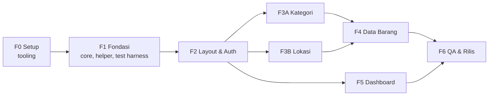

# SI Inventaris Sekolah — Implementation Plan (Indeks)

> **For Claude:** REQUIRED SUB-SKILL: Use superpowers:executing-plans to implement this plan task-by-task.
> Untuk eksekusi paralel per fase gunakan superpowers:subagent-driven-development (satu subagent per fase/task + review).

**Goal:** Membangun Sistem Informasi Inventaris Sekolah (login, dashboard, CRUD barang + foto, master kategori & lokasi) berbasis PHP native + MySQL yang memenuhi seluruh kriteria asesmen JWD.

**Architecture:** Page controller tipis di `public/` → Validator/Service → Repository (PDO prepared) → MySQL. Presentasi di `views/` via `render()`. Model database native di `database/inventarisdb.sql`. JS per fitur (Axios, Chart.js, SweetAlert2), CSS Bootstrap + kustom.

**Tech Stack:** PHP 8.2+, MySQL 8 / MariaDB 10.4+, PDO, Bootstrap 5.3.8, Bootstrap Icons 1.11.3, Axios 1.7.9, Chart.js 4.4.7, SweetAlert2 11.26.25, PHPUnit 11.5, Playwright 1.64.0.

**Root proyek:** `D:/porto vibe/sertikom web/sistem_sekolah/sistem_inventaris` (semua path di rencana relatif terhadap folder ini).

---

## Prompt eksekusi

Prompt siap tempel untuk semua mode (satu agent, orkestrator paralel, per fase, review, pemulihan, demo):
**`docs/PROMPT-EKSEKUSI.md`**.

## Status verifikasi rencana (13 Okt 2026)

Kode di semua file fase telah dirakit dan dijalankan di lingkungan terpisah: 121 blok lolos cek sintaks,
91 unit + 51 integration test lulus (MySQL 8.4.3), 47/47 E2E lulus (desktop + mobile), termasuk mode isolasi paralel.

## Wajib dibaca sebelum mengeksekusi

1. `AGENTS.md` — aturan arsitektur, keamanan, gaya kode, protokol agent.
2. `docs/01-PRD.md` — acceptance criteria & aturan validasi (§7, §8.1).
3. `docs/03-ARSITEKTUR-DAN-FLOW.md` — **§12 Katalog API Internal** (nama fungsi/class wajib sama).
4. `docs/04-DATABASE.md` §4 — angka acuan seed untuk assertion test.

## Graf Dependensi Fase

- **Paralel aman:** F3A ∥ F3B (file terpisah), F4 ∥ F5 (F5 hanya menyentuh `public/index.php`,
  `views/dashboard/*`, `DashboardRepository`, `dashboard.*`, `api/dashboard-stats.php`).
- F4 butuh F3A **dan** F3B (dropdown kategori & lokasi).

## Status Fase

Agent: ubah status sebelum mulai (`IN PROGRESS (nama)`) dan setelah selesai (`DONE` + ringkasan bukti).

| Fase | File rencana | Dependensi | Perkiraan | Status | Bukti (ringkas) |
|---|---|---|---|---|---|
| F0 | [fase-0-setup.md](fase-0-setup.md) | — | 30 mnt | IN PROGRESS (Codex) | |
| F1 | [fase-1-fondasi.md](fase-1-fondasi.md) | F0 | 2 jam | TODO | |
| F2 | [fase-2-layout-auth.md](fase-2-layout-auth.md) | F1 | 3 jam | TODO | |
| F3A | [fase-3a-kategori.md](fase-3a-kategori.md) | F2 | 1,5 jam | TODO | |
| F3B | [fase-3b-lokasi.md](fase-3b-lokasi.md) | F2 | 1,5 jam | TODO | |
| F4 | [fase-4-barang.md](fase-4-barang.md) | F3A, F3B | 4 jam | TODO | |
| F5 | [fase-5-dashboard.md](fase-5-dashboard.md) | F2 | 2 jam | TODO | |
| F6 | [fase-6-qa-rilis.md](fase-6-qa-rilis.md) | F4, F5 | 2 jam | TODO | |

## Daftar Task (ringkas)

| Fase | Task | Keluaran utama |
|---|---|---|
| F0 | 0.1 Git & kerangka folder · 0.2 Composer + PHPUnit · 0.3 npm + salin vendor · 0.4 Browser Playwright | Repo siap, vendor lokal |
| F1 | 1.1 Import DB · 1.2 Config, Database, bootstrap, phpunit · 1.3 Harness DB test + SchemaTest · 1.4 Enums · 1.5 Paginator · 1.6 Helper format · 1.7 Helper security · 1.8 Helper http · 1.9 Helper session · 1.10 Helper view · 1.11 ValidationResult | Fondasi teruji |
| F2 | 2.1 CSS & gambar dasar · 2.2 JS global · 2.3 Layout, partial, halaman error · 2.4 User & LoginAttempt repository · 2.5 AuthService + factories · 2.6 Playwright config + E2E auth (RED) · 2.7 Login/logout/dashboard sementara (GREEN) | Login berfungsi |
| F3A | 3A.1 KategoriValidator · 3A.2 KategoriRepository · 3A.3 E2E (RED) · 3A.4 Halaman kategori (GREEN) | CRUD kategori |
| F3B | 3B.1 LokasiValidator · 3B.2 LokasiRepository · 3B.3 E2E (RED) · 3B.4 Halaman lokasi (GREEN) | CRUD lokasi |
| F4 | 4.1 BarangValidator · 4.2 BarangRepository · 4.3 KodeBarangGenerator · 4.4 UploadService · 4.5 BarangService + factories · 4.6 API kode barang · 4.7 E2E (RED) · 4.8 Daftar · 4.9 Form tambah/edit · 4.10 Detail · 4.11 Hapus · 4.12 GREEN + RBAC | CRUD barang |
| F5 | 5.1 DashboardRepository · 5.2 API statistik · 5.3 E2E (RED) · 5.4 Halaman dashboard (GREEN) | Dashboard |
| F6 | 6.1 E2E responsif · 6.2 Audit keamanan & kualitas · 6.3 README · 6.4 Laporan akhir & tag | Rilis v1.0.0 |

## Konvensi Umum Rencana

- Perintah shell ditulis untuk **Git Bash** (Windows). PowerShell: ganti `cp` → `Copy-Item`.
- `php` di PATH = XAMPP PHP 8.2.12. MySQL CLI Laragon: `/c/laragon/bin/mysql/mysql-8.4.3-winx64/bin/mysql.exe`.
- MySQL **harus aktif** (Laragon → Start All) untuk Task integration & E2E. Jika tidak aktif, hentikan dan minta user menyalakannya.
- Commit tanpa baris atribusi, format `<type>: <deskripsi>`.
- Setiap file PHP non-view diawali `<?php` + `declare(strict_types=1);`.

## Catatan Deviasi Global

*(Agent menambahkan catatan di sini bila mengubah keputusan lintas fase.)*
